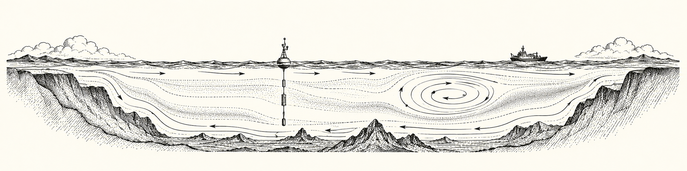

# Oceanography Toolkit



**Incomplete research implementation.** Extracted from OrcaCast into the installable
`toolkit-oceanography` distribution, with Python package and command `oceanography`.
The remaining work is tracked in [TODO.txt](TODO.txt).

Existing research families cover station tides, SalishSeaCast currents, river discharge,
satellite SST and chlorophyll, HYCOM offshore currents, and DFO WebTide harmonics.
Separate source-specific surface products and a [Waves history pipeline](docs/WAVES.md)
extend those families. Production forecast eligibility remains unestablished.

## Install and initialize

Python 3.11+:

```sh
python -m pip install -e '.[test]'
python -m pytest -q
oceanography --help
oceanography init --workspace /path/to/ocean-workspace
```

A regular `python -m pip install .` or wheel install works without OrcaCast or a sibling checkout.
Install `.[tides]` for DFO harmonic reconstruction; it pins UTide 0.3.1 because the research code
uses private UTide APIs. Initialization copies configuration/reference metadata and preserves
existing files; it does not download or build data.

## Structure

```text
src/oceanography/        Research producers, normalization, inspection and CLI
  core/config/          Local configuration support; no OrcaCast imports
  resources/config/     Packaged workspace templates
config/                 Editable configuration templates and research catalog
tests/                  Migrated scientific fixtures and package checks
docs/                   Usage, source contracts, migration and historical pilot notes
TODO.txt                Prioritized unfinished work
```

Read the [documentation index](docs/README.md), [workspace and input guide](docs/SETUP.md),
[configuration reference](docs/CONFIGURATION.md), [workflows](docs/WORKFLOWS.md),
[product definitions](docs/PRODUCTS.md), and [migration report](docs/MIGRATION.md).
Existing datasets remain in their original location. Offline tests do not establish live provider
access, regional reconstruction, map acceptance or application integration.

## Ocean Conditions

The separate `python -m oceanography.daily` workflow creates simple MUR SST and MODIS Aqua chlorophyll products using the approved study water registries. See [daily satellite delivery](docs/DAILY.md) for schemas, source qualifications, preflight and bounded commands. The legacy research families above retain their separate limitations.

Full-date-range acquisition uses the resumable [Ocean Conditions history workflow](docs/HISTORY.md), with explicit SQ/NRT source precedence and promotion after consumer readiness.

The source-specific [HYCOM surface pilot](docs/COARSE.md) adds modeled salinity and geographic currents at R5, with explicit native wet support and separate scientific qualification.
The separate [SalishSeaCast inland surface pilot](docs/REGIONAL.md) adds reference salinity and locally rotated currents at R6; no coarse/regional mosaic is applied.

`oceanography regional-history` provides [monthly historical GLORYS-gap supplements](docs/REGIONAL_GAP_HISTORY.md), with independent salinity/current checkpoints, bounded transient source caching and additive final-daily publication. Optional `--requests-in-flight 2` overlaps monthly source requests under one shared 2 GB cache budget; scientific reduction and checkpoint writes remain serial.

Native-period ENSO context: [contract and validation](docs/CONTEXT.md).

`oceanography liveocean-history` provides separate [LiveOcean surface scalar history](docs/LIVEOCEAN.md)
with bounded S3 ranges, monthly recovery checkpoints and final-Parquet retention.
Its daily-labelled values retain the native 71-hour tidal filter.

`oceanography regional-filtered-pilot` implements the [SalishSeaCast Godin filter
and timing qualification](docs/REGIONAL_FILTERED.md) for surface salinity, oxygen
and nitrate. It preserves legacy daily-mean checkpoints and tests native half-hour
centres explicitly before a historical common-filter run.

The [inner-water source modes](docs/REGIONAL_HYBRID_PLAN.md) are `fast`
(LiveOcean with SalishSeaCast fallback) and `complete` (SalishSeaCast throughout).
Both allow suitable existing regional or coarser coverage on the outer coast.
[`oceanography surface-history --mode fast|complete`](docs/SURFACE_HISTORY.md)
implements regional scalar selection and resumable monthly final H3 partitions;
global inner/outer geographic compositing and currents remain separate workflows.

The [smaller-subset investigation and salt-only LO extension](docs/REGIONAL_SUBSETS.md)
address spatial overfetch and salinity values omitted by earlier target selection.
`liveocean-salinity-extension` adds separate regional H3 partitions; the surface
runner can use that verified extension and optional whole-cell request tiles.

Bounded native tide events: [contract and validation](docs/TIDE_EVENTS.md).

[GLORYS12 anonymous surface pilot](docs/GLORYS.md).

`oceanography waves --study /path/to/config/study.v1.json --start 2009-01-01`
creates separate hourly/daily significant wave height, mean period, FROM direction
and height-derived WMO sea state in `Data/Oceanography/waves/`. Install `.[waves]`.
The [Waves contract](docs/WAVES.md) defines conservative native-point support,
unsupported nulls, complete UTC-day reductions, source vintages and validation.


Separate [regional Waves pipelines](docs/WAVES_REGIONAL.md), installed with
`.[waves-regional]`, expose `waves-salishseacast` and `waves-usgs-nearshore`.
SSC selects canonical half-hourly nowcasts, keeps T02 explicit and preserves
pre-archive/missing dates and unsupported cells as null. USGS publication requires
verified effective 10 m-isobath coordinates; original reference points cannot
satisfy that gate. Existing ERA5 Waves remain separate. The 2026-11-01 SSC backfill
is queued behind an existing acquisition worker; the complete history is not yet
published. See the contract for source endpoints, evidence and resume commands.
